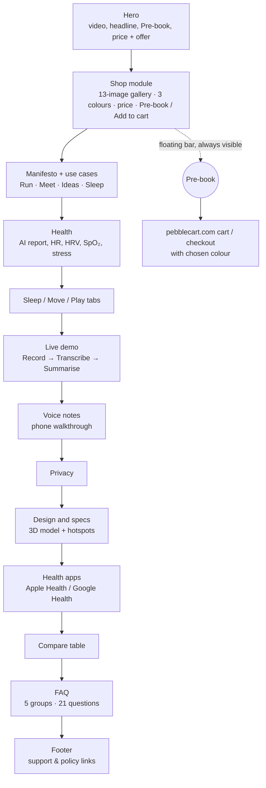
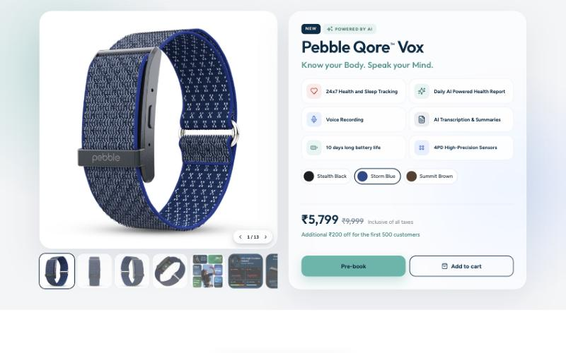
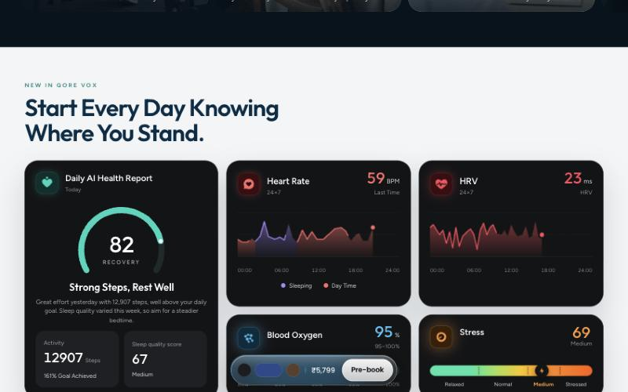
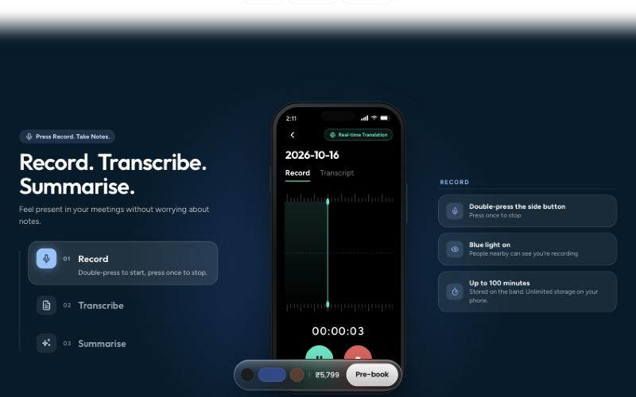
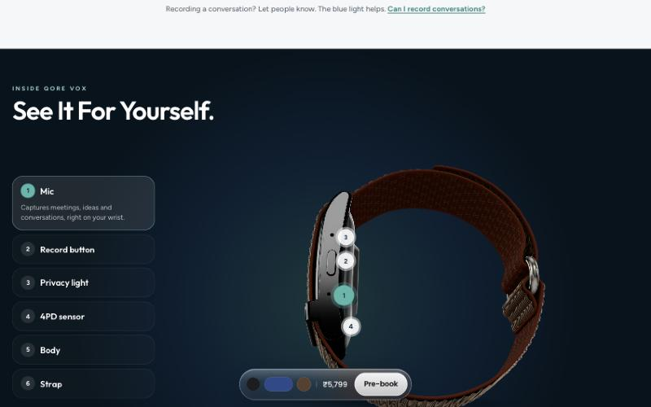
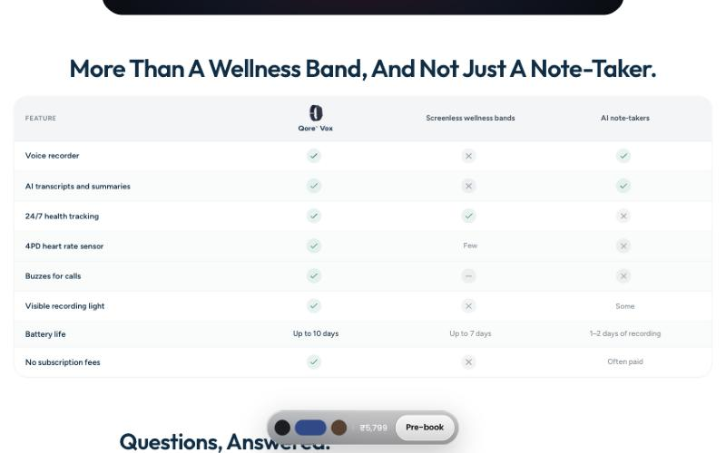
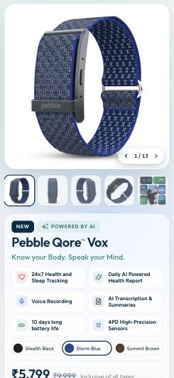

# Pebble Qore™ Vox: Product Launch Page

**A single long-form product page that explains, and sells, a new kind of wearable: a screenless health band that also records and summarises voice notes.**

Consumer electronics · Wearables / wellness · D2C (India) · Client work, launched on the Pebble store
**My role:** Product designer and front-end developer (UX, visual and interaction design, CRO structure, implementation) and creator of the page's AI-generated visuals: videos, lifestyle imagery, 3D model and app screens.

**[Live demo → qore-vox-live.vercel.app](https://qore-vox-live.vercel.app)** · **[Repository → github.com/aditixrawat/qore-vox](https://github.com/aditixrawat/qore-vox)**


---

## Project snapshot

| | |
|---|---|
| **Brand / category** | Pebble, an Indian consumer-electronics brand. Product: Qore™ Vox, a screenless wellness band with a built-in voice recorder and AI transcripts. |
| **Audience** | Indian online shoppers interested in fitness tracking or note-taking, browsing mostly on mobile *(hypothesis, see §6)* |
| **Problem space** | Launching a product that fits no existing category, at a price that needs justifying |
| **My responsibilities** | Page structure and narrative, UI design, interactions, responsive behaviour, buy flow, front-end build |
| **Scope** | One product page: hero, built-in buy section, feature story, specs with a 3D model, comparison table, FAQ. No collection page, cart or checkout of its own. |
| **Stack** | Static HTML, CSS and vanilla JavaScript. Google `<model-viewer>` for 3D, WaveSurfer.js for audio. First built as a Shopify page template, now a static site on Vercel. |
| **Status** | Live on the Pebble Shopify store as a custom page template. This repo is the standalone static version. |
| **Validation** | **None measured.** There's no analytics, A/B test or usability-test data in this repo. Every outcome below is a hypothesis unless marked otherwise. |

> **About the live demo:** `qore-vox.vercel.app` responds, but it serves a slightly different, earlier build than this repo: different page title and `vendor/` script paths. Redeploying from `main` will make them match.

---

## Executive summary

Qore™ Vox merges two products shoppers normally buy separately: a screenless fitness band and an AI voice note-taker. That's the commercial risk. A shopper who arrives expecting either one may not see why this costs more than a basic band, or why a recorder belongs on their wrist.

I designed and built the launch page as **one scrolling page that sells the product first and tells the story second**. A full product purchase module (gallery, colours, price, Pre-book, Add to cart) comes straight after the hero. The page then answers the shopper's questions in order: what it does for health, how voice notes work, whether recording is socially acceptable, what the hardware is, how it compares to alternatives, and the remaining questions as an FAQ. A floating purchase bar keeps the price, colour choice and **Pre-book** within reach throughout.

My priorities were to make the dual purpose obvious in the first 5 seconds, show the product working (simulated dashboards, a recording demo, a 3D model) instead of only describing it, and deal with the privacy objection before shoppers raise it.

---

## Business context & opportunity

**Category and positioning.** Pebble sells wearables in India. Qore™ Vox sits next to Qore™ Ultra, a health-only band at ₹5,999 (see the hidden "Choose your Qore" section, §11). Vox costs ₹5,799 on the page, shown against a struck-through ₹9,999 MRP, with an extra ₹200 off for the first 500 customers. It's sold as a **pre-order** (*Pre-book*).

**Why the purchase is harder than usual.** It's a first-of-its-kind product, so shoppers have nothing to compare it to. The page has to:
1. teach a new mental model ("a fitness band *and* a voice recorder"),
2. justify the price against cheaper single-purpose bands,
3. deal with a **social and privacy worry** that no fitness band faces (being seen as recording people), and
4. ask for a pre-order before anyone has seen reviews.

**Evidence used.** This was a **heuristic, design-led project**. Every friction point below comes from analysing the product and category, not from user research or analytics:

| Problem | Evidence source |
|---|---|
| Hybrid product needs explaining before it can be valued | Designer hypothesis (category analysis) |
| Recording on the wrist raises consent and privacy worries | Designer hypothesis; the brand's own FAQ also has *"Can I record conversations?"* |
| Shoppers compare against cheaper single-purpose devices | Designer hypothesis; this is why the page has a comparison table |
| Pre-order of an unreviewed product needs extra reassurance | Designer hypothesis |

There's no data on conversion, bounce rate or customer complaints for the previous Pebble pages, so none is quoted here.

---

## Problem statement

> For **mobile-first Indian shoppers considering a fitness band or a note-taking gadget**, **an unfamiliar hybrid product with no reviews and an obvious privacy question** makes it hard to **understand what they're getting and commit to a pre-order**. This page tackles that by **putting the purchase module near the top, showing each capability working, answering the privacy question directly, and comparing Vox to the two categories it replaces**.

- **User problem:** "What is this, is it for me, and is it socially OK to wear?"
- **Business problem:** turning launch traffic into pre-orders at a price above single-purpose bands.
- **Out of scope:** collection pages, search, the cart, checkout and account flows. Those belong to the Shopify store (live) or the external pebblecart.com cart (this static build).

---

## Target audience & shopping intent

There are no formal personas or research. These are **behavioural hypotheses** that shaped the structure:

| Intent | What they need before buying | Where the page answers it |
|---|---|---|
| **Ready buyer** (came from an ad or launch post) | Price, colour, a way to buy, right away | Purchase module straight after the hero, floating Pre-book bar |
| **Fitness-first evaluator** | What's tracked, how accurate, battery life | Health dashboard, Sleep/Move/Play tabs, specs |
| **Productivity-first evaluator** | How recording works, transcript quality, languages | Live demo, Voice notes walkthrough, FAQ "Voice Recording & AI" |
| **Sceptic** | Privacy, subscription, how it differs from what I have | Privacy section, comparison table, FAQ |
| **Value checker** | Why this price, is there a cheaper option | MRP strikethrough, launch offer, "No subscription fees" row in the comparison |

**Likely worries addressed in the copy:** being seen as recording people ("A blue light others can see"), where recordings go ("Stored on your band and phone"), hidden costs ("No subscription"), battery ("Up to 10 days"), and whether it's a medical device (FAQ).

---

## UX audit & friction mapping

The journey on this page runs **landing → understanding → evaluation → colour choice → buy**. Collection pages and checkout are outside this page.

| Journey stage | User goal | Possible friction | Design response | Intended outcome |
|---|---|---|---|---|
| **Landing (hero)** | "What is this?" | New category, unclear in one glance | Two-part headline, *Know your Body. Speak your Mind.*, plus the subline "Health tracking and voice notes, now in one screenless band", over a close-up of the privacy light | Both halves of the product understood in about 5 seconds |
| **Ready to buy** | Buy without scrolling through the story | Long storytelling pages hide the buy button | A full purchase module straight after the hero, and a floating bar with colour, price and Pre-book | Short path for people who already want it |
| **Evaluation: health** | "Is it a real fitness tracker?" | Abstract feature lists | Simulated app screens (Recovery 82, heart rate, HRV, SpO₂, stress) with animated counts | Shows what they'd actually get |
| **Evaluation: voice** | "How does recording work?" | Unfamiliar interaction | 3-step Record → Transcribe → Summarise walkthrough in a phone mockup; button gesture spelled out ("Double-press to start") | Lower uncertainty about learning to use it |
| **Worry: privacy** | "Is it creepy or legal?" | Unspoken worry that stops the purchase | A dedicated Privacy section straight after Voice, linked to the FAQ | The worry is handled before it ends the visit |
| **Evaluation: hardware** | "What am I wearing?" | Product photos don't show where the controls are | Rotatable 3D model with 6 numbered hotspots and a specs list | Physical understanding without a store visit |
| **Comparison** | "Why not a cheaper band or an app?" | Shoppers compare in other tabs | Table vs *Screenless wellness bands* and *AI note-takers* | Comparison happens on the page |
| **Colour choice** | Pick a colour | Colour doesn't show in feature images | 3 swatches that swap the whole 13-image gallery and stay in sync with the floating bar | Confident colour choice |
| **Buy** | Pre-order | Leaving the page, losing the chosen colour | CTA sends the *chosen* colour's variant to the store cart | Fewer mistaken orders *(not measured)* |

---

## Product strategy & design principles

| Principle | How it shaped a concrete decision |
|---|---|
| **Buying first, story second** | The purchase module (`#shop`) is the second section, not the last. Storytelling comes afterwards to support people who aren't yet convinced. |
| **Show, don't list** | Health, voice and hardware are each shown as something interactive or animated (dashboard, phone demo, 3D model), not as bullet points. |
| **Answer the worry where it comes up** | Privacy comes straight after the recording demo, the moment a shopper would think "wait, is that OK?" |
| **One persistent way to buy** | A single floating bar (swatches + price + Pre-book) rather than a buy button repeated in every section. Fewer competing calls to action. |
| **Mobile-first, tuned per breakpoint** | The layout has separate desktop (≥980 px), tablet (640–979 px) and mobile (<640 px) versions, not one squeezed layout. See §16. |
| **Keep cognitive load low** | 21 FAQ questions are grouped into 5 collapsible categories, so the page ends calmly instead of with a wall of questions. |

---

## Information architecture & user flow

**Page order as rendered** (in-page links: `#shop`, `#health`, `#voice`, `#design`, `#compare`, `#faq`):



**Why this order.** Capabilities come before hardware: shoppers buy outcomes before components. Comparison and FAQ come last because they serve people who are close to buying and want final reassurance.

**Present in the markup but switched off:** *"A day with Qore Vox"* (a timeline from 7:15 am to 11:00 pm) and *"Choose your Qore"* (a Vox vs Ultra comparison card) are in `index.html` but hidden with `display: none`. The section's own top nav bar is also hidden, because on Shopify the store's header replaced it. In this static build that leaves **no top navigation**. See Limitations.

---

## Design system & visual direction

- **Positioning:** premium-calm tech rather than sporty. Dark navy sections (`rgb(6,20,28)`, `rgb(2,28,43)`) for the "technology" moments (hero, voice, hardware). Light grey and white (`rgb(243,245,247)`) for evaluation content (shop, health, compare, FAQ).
- **Accent:** teal (`rgb(82,182,170)` / `rgb(159,216,207)`) for primary calls to action and the offer line, picking up the band's blue privacy light without competing with it.
- **Typography:** *Outfit* for display headlines, *Figtree* for body text and UI, *Poppins* in parts of the floating bar (Google Fonts). Headlines use short title-case statements ("See It For Yourself.", "Questions, Answered.") to keep a confident, plain tone.
- **Imagery:** Pebble's product shots on clean backgrounds in the shop gallery. Everything else I generated with AI and art-directed: the hero videos, lifestyle scenes for the use cases (running, a client meeting, sleep), the 3D model and the simulated app UI for health and voice. That kept one consistent look across the page and let the band's *output* be shown even though it has no screen.
- **Surfaces:** rounded cards (about 20–22 px radius), soft shadows and frosted glass (`backdrop-filter`) on the floating bar.
- **Motion:** count-up numbers, fade and scale image crossfades, and tab transitions, all on one shared easing curve `cubic-bezier(0.2,0.7,0.2,1)`.
- **Honest note on "system":** there's **no formal token file or component library**. Styles are mostly inline in the markup, with global rules spread across 8 stylesheets in `css/`. It's a consistent visual language, not a reusable design system.

---

## Experience breakdown

### A. Hero (`#overview`)
Autoplaying, muted product video that I generated with AI (separate desktop and mobile edits, loaded from Shopify's CDN). Headline in two parts, one-line explanation, a single **Pre-book** call to action, the price "inclusive of all taxes", and an offer line. One call to action only: the hero's job is understanding, not choice.

### B. Product purchase module (`#shop`)
- **Gallery:** 13 images per colour, with previous/next arrows, a "1 / 13" counter and a thumbnail strip. **Verified:** picking *Stealth Black* swaps the whole gallery to that colour's image set.
- **Value summary:** six feature tiles (24×7 health and sleep, daily AI report, voice recording, AI transcription, 10-day battery, 4PD sensors) so the dual purpose is visible next to the price.
- **Price:** ₹5,799 with ₹9,999 MRP struck through, "Inclusive of all taxes", and the launch offer.
- **Buttons:** **Pre-book** (primary, filled) and **Add to cart** (secondary, outlined).



### C. Feature story
| Section | What it shows |
|---|---|
| Health | Simulated app cards: Recovery 82, heart rate and HRV charts, SpO₂ 95 %, stress gauge |
| Sleep / Move / Play | Tabbed overlays for sleep stages, activity rings and sports |
| Live demo + Voice | 3-step recording walkthrough in a phone mockup, with a waveform and a "Real-time Translation" label |
| Privacy | "Only when you press", "A blue light others can see", "Stored on your band and phone" |
| Design & specs | 3D model with 6 hotspots (Mic, Record button, Privacy light, 4PD sensor, Body, Strap) and a specs list (IP68, Bluetooth 5.4, 53 g, magnetic charging) |
| Health apps | Syncs with Apple Health and Google Health |

| Health dashboard | Voice walkthrough | 3D hardware tour |
|---|---|---|
|  |  |  |

### D. Comparison (`#compare`)
Feature-by-feature table against **screenless wellness bands** and **AI note-takers**, covering voice recorder, transcripts, 24/7 tracking, heart-rate sensor, call alerts, recording light, battery and subscription cost. Framing Vox against two categories, rather than named competitors, helps sell the hybrid idea.



### E. FAQ (`#faq`)
21 questions in 5 collapsible groups: About Qore Vox, Health, Recovery & Fitness, Voice Recording & AI, Privacy & Recording, Everyday Use & Design. **Verified:** toggles update `aria-expanded`.

### F. Cart and checkout
**Not built here.**
- On Shopify, the page used the store's own cart side panel and the GoKwik checkout.
- In this static build, `js/standalone.js` intercepts the buy buttons and sends shoppers to the chosen colour's variant on **pebblecart.com**:
  - **Buy now / Pre-book** go to `/cart/{variant}:1` (straight to checkout).
  - **Add to cart** goes to `/cart/add?id=…`.
- The redirect logic was **checked by reading the code, not clicked through** to the store.

### Mobile

| Mobile hero | Mobile purchase module |
|---|---|
|  |  |

---

## CRO strategy & hypotheses

**None of these have been tested.** They're the experiments I would run first, ranked by how directly they relate to the purchase.

### H1: Purchase module straight after the hero vs at the end
- **Issue:** storytelling pages often put the buy section last, so ready buyers have to scroll through a lot first.
- **Evidence / confidence:** designer hypothesis · medium.
- **Hypothesis:** *We believe that placing the full purchase module directly after the hero, for launch traffic, will raise the share of sessions that start a pre-order, because shoppers who arrive already wanting it can act at once while others keep scrolling. We'll measure Pre-book click-through per session while watching revenue per visitor and the return / cancellation rate.*
- **Behavioural mechanism:** less effort for high-intent visitors.
- **Control:** module after the FAQ. **Variant:** current order.
- **Segment:** all traffic, split by device.
- **Primary metric:** Pre-book clicks ÷ sessions.
- **Guardrails:** completed checkouts ÷ sessions; cancellation rate on pre-orders.
- **Confounders:** ad creative mix; launch-day traffic spikes.

### H2: Privacy section placed straight after the voice demo
- **Issue:** recording is the new, slightly uncomfortable feature.
- **Evidence / confidence:** hypothesis, supported by the brand already having a "Can I record conversations?" FAQ · medium.
- **Hypothesis:** *We believe that answering the privacy question straight after the recording demo will reduce drop-off at that point in the page, because an unanswered social worry stops intent. We'll measure scroll continuation past #voice and Pre-book clicks per session, while watching time to first Pre-book.*
- **Control:** privacy content only in the FAQ. **Variant:** current inline section.
- **Required before rollout:** scroll-depth tracking per section (not built yet).

### H3: Comparison against categories instead of named brands
- **Hypothesis:** *We believe that comparing Vox to "wellness bands" and "AI note-takers" will help evaluators see the combined value and justify the price. We'll measure Pre-book clicks per visitor who views #compare, while watching the share of Ultra purchases (cannibalisation).*
- **Confidence:** low to medium. The metric only counts people who scroll that far, so it overstates the effect unless compared against a holdout group.

### H4: Floating bar with colour swatches vs a plain button
- **Hypothesis:** *We believe that showing swatches inside the floating bar will reduce wrong-colour orders and drop-off between choosing a colour and buying. We'll measure Pre-book clicks per session, while watching colour-change cancellations.*
- **Note:** more clicks on the bar on their own **would not prove more sales**. The success metric has to be completed checkout.

**Metric definitions to set up first:**
- `session_start`
- `section_view{id}` (50 % visible)
- `cta_click{location, label, variant}`
- `checkout_started`
- `order_completed`

The repo currently has **no analytics code at all**.

---

## Design decisions & trade-offs

1. **Buying before storytelling.**
   - *Trade-off:* the hero-to-shop jump comes before the emotional story, which risks seeming pushy to people who are just browsing.
   - *Why:* launch traffic is often high-intent, and the story is still there one scroll down.
   - *How to validate:* H1.
2. **Simulated app screens instead of real screenshots or a feature list.**
   - *Trade-off:* simulated numbers (Recovery 82, 12,907 steps) can read as marketing.
   - *Why:* the band has no screen, so its value only exists in the app, and shoppers need to see that output.
   - *How to validate:* usability test. Do shoppers understand where the data appears?
3. **Facing privacy head-on.**
   - *Trade-off:* mentioning a worry can introduce it to people who never had it.
   - *Why:* for a wrist recorder, the worry is near-universal, and leaving it unanswered is worse.
   - *How to validate:* H2.
4. **A 3D model instead of more photos for hardware.**
   - *Trade-off:* the model file is large (it loads from the store CDN), and model-viewer adds about 1 MB of JavaScript.
   - *Why:* it's the only way to show where the mic, button and light sit without a store visit.
   - *Mitigation:* it loads only when needed (see `loadMV` in `qv-app.js`).
5. **One floating buy bar instead of a button in every section.**
   - *Trade-off:* fewer visible prompts to buy.
   - *Why:* one consistent way to buy, which also carries the chosen colour everywhere.

*These are the reasons for the build as shipped. No alternative designs were formally prototyped or tested, so none are claimed.*

---

## Interaction design

| Interaction | Trigger → response | State / edge cases |
|---|---|---|
| Colour swatch | Click → gallery swaps to that colour's 13 images; ring moves to the chosen swatch; floating bar stays in sync | Default selection is Storm Blue. The buy redirect falls back to Stealth Black if nothing is selected. |
| Gallery | Arrows, thumbnails or counter → crossfade; counter updates (1/13 → 2/13, verified) | |
| Health counters | Section enters view → numbers count up | Scroll-linked animations are turned off when `prefers-reduced-motion` is set |
| Voice steps | Tab or scroll → phone mockup switches between Record, Transcript and Summary views; waveform via WaveSurfer | |
| 3D hotspots | Click a hotspot list item → model rotates to that part | Model loads lazily. Placeholder text "Loading 3D model…" is removed once it loads. |
| FAQ | Click a group → expands; `aria-expanded` toggles | |
| Buy buttons | Click → redirect to pebblecart.com with the chosen variant | No loading state before the redirect |
| Hero video | Autoplays muted and looped; separate mobile file | Paused under reduced motion |

---

## Responsive design & accessibility

**Responsive.** Three layout versions (≥980, 640–979, <640 px) plus 30+ extra media-query adjustments, including 360 px and 390 px fixes. **Verified at 375 × 812:** no horizontal scroll.

**Accessibility: what's in place**
- `lang="en"`, one `<h1>` and 12 `<h2>`s
- `aria-label` on swatches and gallery controls
- `aria-expanded` on FAQ toggles
- All 44 images have an `alt` attribute (27 empty, used for decorative images)
- `prefers-reduced-motion` respected in CSS (smooth scrolling) and JS (animations, hero video)

**Known gaps (measured in a quick DOM check at 375 px, not a full audit)**
- 24 of 105 interactive elements are smaller than 44 × 44 px. For example, the gallery arrows are 28 × 28 and the colour swatches 104 × 28.
- There's no `<main>` landmark.
- Keyboard focus order and visible focus states haven't been tested.
- Colour contrast hasn't been audited. Light teal text on white (the offer line) needs checking.
- One console error: a malformed SVG `path` attribute in an animated graphic.
- **No WCAG compliance is claimed.** Next step: an axe-core pass, a keyboard-only walkthrough and a VoiceOver/TalkBack check of the gallery and FAQ.

---

## Technical implementation

| Area | Implementation |
|---|---|
| Markup | One `index.html` (about 210 KB). It started as a Shopify section (`sections/qore-vox.liquid`) with a custom layout, then was converted to static HTML for this repo. |
| Rendering | `js/qv-app.js` picks a breakpoint and lazily loads compressed layout data for that size (`js/qv-data-{d,t,m}.js`, about 950 KB each). It then updates the existing page in place when the breakpoint, colour or tab changes, instead of rebuilding it. |
| Patches | `js/qv-tweaks.js` uses a `MutationObserver` to apply content and layout fixes after rendering: price and MRP, the offer line, regrouping the FAQ, the hero video. |
| Feature scripts | `qv-gallery.js` (colour-specific galleries), `qv-overlays.js` (Sleep/Move/Play), `qv-sleep.js` (sleep chart, mobile hero video) |
| Buy flow | `js/standalone.js`: capture-phase click handler that redirects to the pebblecart.com cart |
| Libraries | Google `<model-viewer>` + meshopt decoder (3D), WaveSurfer.js (audio waveform) |
| Data | All product data is hard-coded. Variant IDs are the real Shopify variant IDs. There's no backend or API calls from this build. |
| External assets | Hero videos, gallery images and the 3D model load from `cdn.shopify.com` / `pebblecart.com` |
| Analytics | **None** |
| Hosting | Vercel (static, no build step) |

**Technical debt worth knowing about:**
- The static HTML still contains ₹6,999. `qv-tweaks.js` rewrites it to ₹5,799 at runtime, so pricing lives in JavaScript rather than the source.
- Dependence on the Shopify CDN means deleting assets from the store would break this site.

---

## Performance & quality

Measured once in a **local** Chromium session (1280 × 800, `python -m http.server`, warm cache). This is lab data on localhost, **not real-user Core Web Vitals**.

| Metric | Value | Note |
|---|---|---|
| LCP | ~1.4 s | LCP element was the `<h1>`. On localhost, so network cost is mostly excluded. |
| CLS | 0.009 | Within the "good" threshold in this run |
| INP | Not measured | |
| Shopify CDN transfer on load | ~2.6 MB images + ~2.3 MB video | Before any 3D model download |
| JS shipped | ~3.9 MB in `js/`, but only one ~950 KB layout file loads per breakpoint; model-viewer ~1 MB | |
| Runtime errors | 1 (SVG path attribute) | |
| Missing files (404s) | 0 in the final check | |

**To validate next:** Lighthouse and PageSpeed Insights on the deployed Vercel URL over mobile 4G, plus real-user Core Web Vitals once analytics is added.

---

## Results & impact

| Category | Status |
|---|---|
| **A. Measured results** | None available. No analytics or experiment data. |
| **B. Usability findings** | None. No user testing was run. |
| **C. Implementation outcomes** | Launched as a Shopify page template on the Pebble store. Converted to a dependency-free static site that deploys to Vercel. Colour-synced gallery, 3D tour, recording demo and grouped FAQ checked working in-browser. |
| **D. Expected outcomes** | Shorter path to Pre-book for high-intent visitors; fewer privacy-driven drop-offs; better understanding of the hybrid product. *All unvalidated.* |
| **E. Still to validate** | Does the shop-first order raise checkout starts? Does the privacy section change drop-off? What's the mobile LCP on real networks? |

To show business impact you'd need: Pre-book clicks per session and orders per session from Shopify analytics before and after launch, ideally with an A/B split on H1.

---

## Limitations & learnings

- **No top navigation in the static build.** It relied on the Shopify store header. On a ~12,700 px-tall desktop page that makes it hard for people to orient themselves. *Learning:* a component that "borrows" a host page's header needs its own fallback.
- **Runtime patching** (`qv-tweaks.js`) grew as fixes accumulated after rendering. It works, but it makes the source misleading (the price example). *Next time:* fix the source template, and limit runtime patching to things that are genuinely dynamic.
- **Two finished sections are hidden** ("A day with…" and the Vox vs Ultra card). The Vox vs Ultra card answers a real question, *"which Qore should I buy?"*. Hiding it removes help for that decision. It's a candidate to test rather than delete.
- **Small touch targets** on the gallery arrows and swatches. That's exactly where mobile shoppers tap most.
- **No measurement built in**, so every CRO claim here is a hypothesis. *Learning:* add event tracking alongside the first build, not after.

---

## Next iterations (directional Impact × Confidence ÷ Effort)

| # | Opportunity | Change | Impact | Confidence | Effort | How to measure |
|---|---|---|---|---|---|---|
| 1 | Can't measure anything | Add the event set from §12 (GA4 or Shopify Pixels) | High | High | Low | Events firing; funnel visible |
| 2 | No way around a long page | Restore a slim sticky nav linking to `#shop`, `#health`, `#voice`, `#compare`, `#faq` | Med | Med | Low | Section-jump clicks; scroll depth |
| 3 | Mobile tap accuracy | Enlarge the arrows and swatches to at least 44 px | Med | High | Low | Mis-tap rate; colour-change cancellations |
| 4 | Vox vs Ultra decision | Re-enable "Choose your Qore" as an A/B variant | Med | Low | Low | Orders per session for both products; mix shift |
| 5 | Mobile speed | Self-host and compress the hero video and gallery images; preload the hero poster | Med | Med | Med | Mobile LCP (real users) |

Scores are judgement-based and not backed by data.

---

## Project structure & local setup

```
index.html      the page
css/            8 stylesheets (base, overrides, mobile, cards, overlays, polish…)
js/             app, layout data, feature scripts, vendor libs, standalone.js (buy redirect)
assets/         images, audio, 3D model
docs/screenshots/  README images
```

No build step and no dependencies. Serve the folder with any static server:

```bash
npx serve .
```

**Deploy:** import the repo into Vercel with framework set to "Other". `index.html` at the root is served as is.

---

## Credits & attribution

- **Design, front-end and visual assets:** Aditi Rawat. All imagery and video, apart from the product photos in the purchase-module gallery, is AI-generated by me. That includes the hero videos, lifestyle and use-case images, the 3D model and the simulated app screens.
- **Brand, product photos (purchase-module gallery) and product facts:** Pebble.
- **Open source:**
  - [`<model-viewer>`](https://github.com/google/model-viewer) (Apache-2.0) and the [meshoptimizer](https://github.com/zeux/meshoptimizer) decoder (MIT)
  - [WaveSurfer.js](https://github.com/katspaugh/wavesurfer.js) (BSD-3-Clause)
- **Fonts:** Outfit, Figtree and Poppins via Google Fonts (SIL Open Font License)
